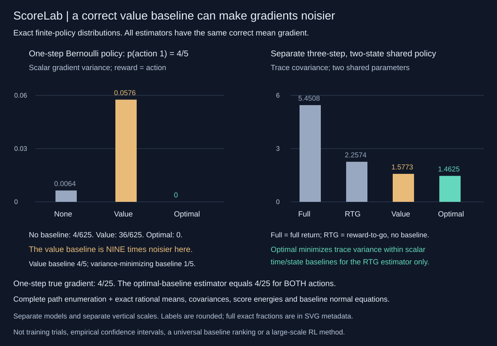

# ScoreLab

Exact policy-gradient distributions, not noisy training curves. A dependency-free finite-model laboratory for score-function gradients, reward-to-go, value baselines and variance-minimizing control variates. Full trajectory witnesses, rational means/covariances and an independently checked expected-return derivative. Python 3.10+, strict JSON CLI, no network or model downloads.



## A correct value baseline can make the gradient nine times noisier

Take one Bernoulli action with `P(action=1)=4/5`, reward equal to the action, and a single logit parameter. Its expected reward is `4/5` and its exact gradient is `4/25`. The score is `1/5` after action 1 and `-4/5` after action 0. A baseline changes each estimate to `score * (reward - baseline)`.

| Estimator | Baseline | Mean gradient | Per-trajectory gradient variance |
|---|---:|---:|---:|
| No baseline | 0 | 4/25 | 4/625 |
| Exact state value | 4/5 | 4/25 | 36/625 |
| Variance-minimizing scalar baseline | 1/5 | 4/25 | 0 |

The value baseline is **exact**, yet has nine times the variance of no baseline in this example. With baseline `1/5`, both possible actions produce the same gradient estimate `4/25`, so its variance is zero. Full-return and reward-to-go coincide at one step. This is an explicit counterexample, not a claim that value baselines usually hurt or that zero variance is generally available.

A separate three-step, two-state model shares two policy parameters across both states, has random transitions and signed rewards. Its complete distribution has 64 positive-probability trajectories. Trace covariances, rounded only here and in the chart, are:

| Estimator | Trace covariance |
|---|---:|
| Full-return score function | 5.4508 |
| Reward-to-go, no baseline | 2.2574 |
| Reward-to-go, exact time/state value baseline | 1.5773 |
| Reward-to-go, variance-minimizing time/state baseline | 1.4625 |

The sequential policy's exact gradient is `[1238843/7962624, -4477/31104]`. All four estimator means equal it exactly. The two chart panels use **different vertical scales** because they are separate models and different variance magnitudes. No empirical learning speed, confidence interval or universal ordering is inferred from these fixtures.

```sh
python -m scorelab demo
python -m scorelab audit examples/two-state.json
python -m unittest discover -s tests -v
PYTHONPATH=. python examples/render_audit.py --check
python -m pip install .
scorelab demo
```

## Exact rational gradients at a softmax anchor

For known state/action weights `w` and integer feature vectors `phi`, ScoreLab audits the parameterized policy

```text
p_theta(a|s) = w(s,a) * exp(phi(s,a) dot theta)
               / sum_b w(s,b) * exp(phi(s,b) dot theta)
```

at **theta = 0**. Thus `p(a|s)=w(s,a)/sum_b w(s,b)` and the log-probability score is `phi(s,a) - sum_b p(b|s)*phi(s,b)`. Both are rational at this anchor. Parameters are shared wherever their feature coordinates are used. Transitions and rewards are fixed and independent of theta. There is no floating-point softmax in the production audit, no policy training, and no claim that all nonzero-theta softmax probabilities are rational.

```python
from scorelab import audit
from scorelab.demo import sequential

report = audit(sequential(), horizon=3)
assert report["exact_gradient"] == [[1238843, 7962624], [-4477, 31104]]
assert all(x["mean"] == report["exact_gradient"]
           for x in report["estimators"].values())
```

The audit separately computes expected return and its exact derivative by a backward sensitivity recursion. It then enumerates all complete positive-probability state/action paths and returns:

- Every path's probability, states/actions/next states, rewards, scores, return-to-go and gradient vector under every estimator.
- Each estimator's exact mean, full second-moment matrix, full covariance and trace variance.
- Every time/state baseline node's occupancy, exact value, optimal baseline, score energy, score/gradient correlation and identifiability flag.
- The full control-variate Gram matrix and each reward-to-go baseline's exact excess trace variance over the optimum.

Fractions serialize as `[numerator,positive_denominator]`. All zero-probability transitions are omitted from the trajectory list, but every time/state baseline node remains present. An unvisited or zero-score node has zero energy; its optimal baseline is unidentifiable and canonically reported as zero, **not** as proof that its conditional value is zero.

## Why the optimal baseline is not the state value

Let `G0` be the full **reward-to-go gradient vector** on a trajectory. For time/state node j, let `Z_j` be its score vector if visited and zero otherwise. A deterministic scalar baseline b_j gives `G_b = G0 - sum_j b_j Z_j`. Conditional score means vanish, so subtracting these action-independent baselines preserves the expected gradient. It does not guarantee lower variance.

For distinct time/state nodes, `E[Z_i dot Z_j]=0`: same-time distinct states cannot both occur, and the later score has zero conditional mean. Therefore each identifiable optimal scalar baseline is

```text
b_j* = E[Z_j dot G0] / E[||Z_j||^2]
trace_cov(G_b) - trace_cov(G_b*) =
    sum_j E[||Z_j||^2] * (b_j - b_j*)^2
```

The numerator uses the **entire** gradient vector G0, including other times. It is not generally a local reward-weighted average or the exact state value. ScoreLab returns both sides of the exact excess-variance identity. A supplied custom baseline is also audited:

```python
custom = audit(sequential(), horizon=3,
               baseline=[[[0,1],[7,1]], [[1,1],[2,1]], [[3,1],[-1,1]]])
assert custom["estimators"]["custom_baseline"]["mean"] == custom["exact_gradient"]
```

“Optimal” means minimum **Euclidean trace covariance within deterministic scalar time/state baselines for reward-to-go**. It depends on parameterization and is not a coordinatewise optimum, an optimum over all unbiased estimators, a fitted critic, or a guarantee relative to the separate full-return estimator. Baselines are held fixed inside the score estimator; the API does not accept action-dependent baselines, random fitted baselines or policy updates.

## Strict model and budget contract

The input has exactly `version: 1`, `model`, `horizon`, and optional `baseline`. The model has exactly `weights`, `features`, `transitions`, `rewards` and `initial_state`; see [examples/two-state.json](examples/two-state.json).

- 1..3 states, 1..3 actions per state, 1..3 shared feature coordinates; rectangular shapes required. Positive integer weights are 1..16 and integer features -8..8.
- Transition/reward arrays have shape `[states][actions][next_states]` of rational pairs. Numerators are -32..32, denominators 1..16; transition probabilities must be nonnegative and sum exactly to one per state/action row. Rewards may be negative.
- Horizon is integer 0..6; initial state is an in-range integer. Booleans, floats and malformed shapes are rejected. A custom baseline has shape `[horizon][states]` of rational pairs with the same bounds.
- Duplicate JSON keys, extra fields and input over 64 KiB are rejected. `--trajectory-limit` defaults to 4,096 and accepts integer 1..8,192.
- A count-only dynamic program computes the **exact complete positive-path count** using transition support before trajectory generation. Refusal produces no partial audit. The full 2-state/2-action horizon-three fixture has 64 paths; limit 63 refuses, limit 64 succeeds.

The path cap bounds complete records, not rational bit lengths, total intermediate arithmetic, serialized bytes, wall time or RAM. Zero horizon has one empty trajectory, zero return/gradient/covariance and no baseline nodes. The code does not sample, alter global RNG state, call a service or need a dataset. A four-module wheel reproduces the demo outside the source checkout.

## Independent verification

22 tests cover:

- **256 one-step Bernoulli policies** with analytic gradient, value baseline, variance-optimal baseline and variance formulas, including the exact ninefold failure above.
- **24 shared-parameter sequential model/horizon settings**, with 48 coordinate derivatives checked by a separate dual-number Cartesian path oracle. It differentiates normalized affine tilts with the same derivative as the exponential family at zero, without production scores, trajectory recursion or backward sensitivities. Central finite differences independently check the actual exponential policy objective.
- All covariance entries against a separate Cartesian action/next-state enumeration, trajectory probabilities/rewards/returns-to-go, positive-semidefinite 2-D covariance minors, full Gram orthogonality, normal equations and custom-baseline excess variance.
- Zero horizon, single action, zero scores, unreachable states, three states/actions/features, signed rewards, exact support counts and refusal before enumeration, strict validation/CLI, input/output/RNG isolation, feature-shift invariance and constant-reward-shift identities.
- Four SVG tests check every one of seven bars and both stated scales, numeric text geometry, complete compressed metadata, byte regeneration and rejection of changed undisplayed trajectory/covariance data.

The SVG embeds the complete exact demo, including trajectory witnesses, as zlib-compressed base64 in `<metadata data-encoding="zlib+base64">`. Decode with `json.loads(zlib.decompress(base64.b64decode(metadata_text)))`. Compression only changes storage; chart label rounding never changes the underlying JSON. The renderer refuses a changed or incomplete demo.

## Attribution and limits

Score-function/control-variate reasoning and the warning that familiar baselines can be suboptimal are standard. [Greensmith, Bartlett and Baxter, *Variance Reduction Techniques for Gradient Estimates in Reinforcement Learning*, JMLR 5 (2004), Sections 4-6](https://jmlr.org/papers/volume5/greensmith04a/greensmith04a.pdf) studies these ideas in its GPOMDP/average-reward setting. ScoreLab does **not** implement GPOMDP or reproduce that paper's experiments/theorems. Its finite-horizon anchor model, exact full-path covariance audit, scalar time/state baseline derivation, code, fixtures, independent oracles and figure are original implementations. No external code or dataset is copied. [DESIGN.md](DESIGN.md) supplies the finite-horizon derivation. MIT licensed.

Everything depends on the supplied finite model. There is no environment fitting, actor-critic training, continuous state/action method, learned baseline, correlated data, infinite horizon, causal explanation of training or large-scale policy-gradient performance claim. Exact arithmetic validates the calculation, not the realism of a model.
